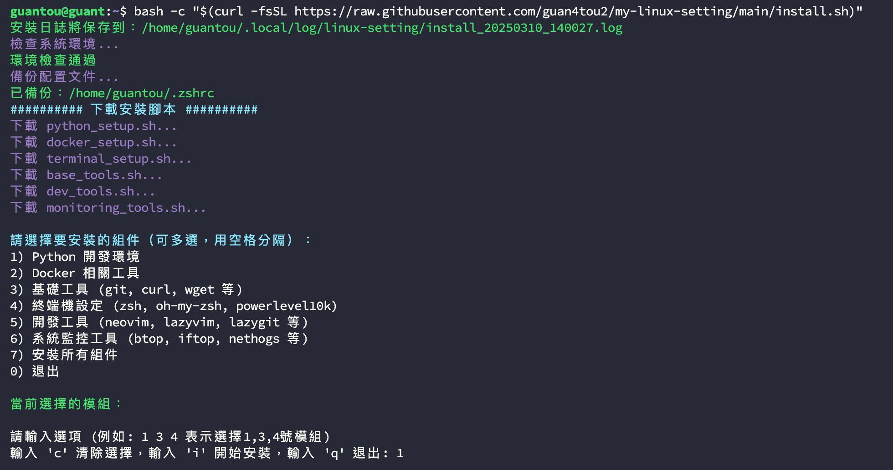

## Linux 環境設定腳本

快速建立 Debian 系列 Linux 開發環境的自動化安裝腳本，支援互動式選單、模組化安裝與詳細日誌。

### 🐧 支援的平台

每次變更都會在 CI 上對下列平台執行完整安裝並驗證結果，只測各發行版的**最新版本**：

| 發行版 | 測試對象 | 架構 |
|---|---|---|
| Ubuntu | 最新 LTS（`ubuntu:latest`） | x86_64、arm64 |
| Debian | 目前的 stable（`debian:stable`） | x86_64、arm64 |
| Kali Linux | rolling（實驗性，失敗不擋合併） | x86_64 |

- 較舊的版本（例如 Ubuntu 22.04）沒有 CI 覆蓋；針對它們的備援邏輯仍保留，但不保證可用。
- 其他 Debian 系列（Linux Mint、Pop!_OS 等）理論上可用，未經測試。
- RHEL、Arch、SUSE 系列**目前不支援**：程式會偵測套件管理器，但模組的套件名稱是 apt 的，實際安裝不會成功。

### ✅ 主要特色

- 一行指令遠端安裝
- 在 x86_64 與 arm64 上皆可使用
- 互動式選單自由選擇模組
- 完整開發環境：Python / Docker / 終端 / 編輯器 / 監控工具
- 安裝前自動備份設定檔；可用 `./install.sh --rollback` 還原，或用 `./uninstall.sh` 移除本工具安裝的內容
- 使用 uv 作為預設 Python 包管理器

---

## 🚀 快速開始

### 標準安裝（推薦）

```bash
bash -c "$(curl -fsSL https://raw.githubusercontent.com/guan4tou2/my-linux-setting/main/install.sh)"
```

啟動互動式選單，選擇要安裝的模組（Python、Docker、基礎工具、終端機、開發工具、監控工具）。

---

## ⚙️ 指令列選項

```bash
# 最小安裝
bash -c "$(curl -fsSL https://raw.githubusercontent.com/guan4tou2/my-linux-setting/main/install.sh)" -- --minimal

# 更新模式
bash -c "$(curl -fsSL https://raw.githubusercontent.com/guan4tou2/my-linux-setting/main/install.sh)" -- --update

# 預覽模式
bash -c "$(curl -fsSL https://raw.githubusercontent.com/guan4tou2/my-linux-setting/main/install.sh)" -- --dry-run

# 詳細模式
bash -c "$(curl -fsSL https://raw.githubusercontent.com/guan4tou2/my-linux-setting/main/install.sh)" -- --verbose

# 還原最近一次安裝前的設定檔備份（不需要 sudo，不會下載任何東西）
bash -c "$(curl -fsSL https://raw.githubusercontent.com/guan4tou2/my-linux-setting/main/install.sh)" -- --rollback
```

**參數說明：**

- `--minimal`：最小安裝模式
- `--update`：更新已安裝工具
- `--dry-run`：預覽將要安裝的內容
- `--rollback`：把最近一次安裝前的備份（`~/.zshrc`、`~/.p10k.zsh`、`~/.config/nvim`）還原到原位置；目前的檔案會先另存為 `.before-rollback`；搭配 `-y` 或 `--non-interactive` 時不詢問
- `-v / --verbose`：顯示詳細日誌
- `-h / --help`：顯示幫助訊息

### 性能優化選項

透過環境變數控制性能優化功能：

```bash
# 停用並行安裝（預設啟用）
ENABLE_PARALLEL_INSTALL=false ./install.sh

# 調整並行任務數（預設 4）
PARALLEL_JOBS=8 ./install.sh
```

**優化功能：**

- 並行安裝：同時安裝多個套件（提升速度約 30%）
- APT 優化：自動配置 APT 並行下載與快取（提升速度約 20%）

---

## 🧩 安裝模組

- **Python 開發環境**：python3, pip, uv, ranger-fm, s-tui
- **Docker 工具**：docker-ce, docker-compose, lazydocker（Kali 使用發行版套件庫的 `docker.io`，因官方安裝程式不支援 Kali；其他發行版若官方安裝程式失敗，會清掉本次新增的 Docker apt 來源並改裝 `docker.io`；最後仍沒有 `docker` 指令則該模組回報失敗）
- **基礎工具**：git, curl, wget, lsd, bat, ripgrep, fd-find, fzf
- **終端機設定**：zsh, oh-my-zsh, powerlevel10k, zsh-autosuggestions, zsh-syntax-highlighting
- **開發工具**：neovim (LazyVim), lazygit, nodejs, cargo, lua
- **監控與安全**：btop, htop, iftop, nethogs, fail2ban

---

## 📸 安裝畫面預覽



---

## 🧪 測試與開發

### 本地測試

```bash
./tests/run_all_tests.sh            # 測試入口（依賴/功能測試僅 Linux CI 預設執行）
./tests/test_dependencies.sh        # 依賴檢查
./tests/test_functionality.sh       # 功能測試
./tests/run_shellcheck.sh           # 受版控腳本：錯誤阻擋 CI，警告僅摘要
./tests/verify_install.sh python base docker terminal dev monitoring  # 安裝成果斷言
./scripts/config/preview_config.sh  # 預覽配置
```

```bash
FORCE_LINUX_TESTS=true ./tests/run_all_tests.sh   # 本機強制執行 Linux-only 測試
```

### Docker 測試

```bash
./docker-test.sh build && ./docker-test.sh test    # 快速測試
BASE_IMAGE=debian:stable ./docker-test.sh build                # 指定其他基底映像（預設 ubuntu:latest）
./tests/test_full_simulation.sh                             # 新容器內 HTTP 遠端安裝與成果驗證
./docker-test.sh run "CI=true bash tests/test_tui_smoke.sh"    # whiptail、fzf、gum 後端的成功／失敗操作流程（TUI_SMOKE_BACKENDS="fzf gum" 可指定後端；缺後端時 CI=true 會用 apt 安裝，否則略過）
./docker-test.sh run "CI=true bash tests/test_docker_module.sh" # 實際安裝 Docker 模組，驗證 docker／lazydocker 可執行且 apt-get update 仍成功
# tests/simulate_remote_install.sh 在 Linux 容器內服務專案並從空目錄安裝
```

---

## 🛠️ 系統維護

```bash
./scripts/maintenance/health_check.sh # 健康檢查
./scripts/maintenance/update_tools.sh # 更新工具
./uninstall.sh --dry-run              # 預覽卸載動作（不執行）
./uninstall.sh                        # 依安裝清單移除本工具安裝的內容（-y 不詢問）
```

---

## 🧾 顯示模式

透過 `TUI_MODE` 環境變數控制輸出詳細程度：

- `quiet`（預設）：只顯示關鍵步驟
- `normal`：顯示完整安裝輸出
- TUI 使用導覽式流程：勾選模組 → 確認摘要 → 安裝（顯示每個模組的進度）→ 結果畫面
- 勾選清單預設只選尚未安裝的模組；最後一列可開啟進階模式，逐模組挑選套件
- 結果畫面可「重試失敗的模組」、「查看安裝日誌」或重新選擇
- 終端機小於 15 列或 50 欄時自動改用純文字選單
- `TUI_LOG_LINES` 可控制 TUI 日誌檢視器顯示的尾端行數（預設 300）

```bash
TUI_MODE=normal ./install.sh --verbose
TUI_LOG_LINES=500 ./install.sh
```

### 互動選單後端

透過 `TUI_BACKEND` 指定互動選單工具：

- `auto`（預設）：優先使用 `gum`，其次 `fzf`，最後 `whiptail`
- `gum`：較現代的 shell TUI，適合選單、確認、輸入
- `fzf`：適合大量項目搜尋與多選
- `whiptail`：傳統 fallback，系統相容性較高

```bash
TUI_BACKEND=fzf ./install.sh
TUI_BACKEND=gum ./install.sh
TUI_BACKEND=whiptail ./install.sh
```

可選工具安裝：

```bash
# Kali / Debian / Ubuntu
sudo apt install -y fzf

# 若已有 Homebrew / Linuxbrew
brew install gum
```

---

## 📁 重要檔案位置

- Shell：`~/.zshrc`, `~/.p10k.zsh`
- Neovim：`~/.config/nvim`
- Python 虛擬環境：`~/.local/venv/system-tools`

---

## 🔒 安全性與信任模型

這個安裝程式會從網路下載程式並在你的機器上執行，其中不少步驟需要 `sudo`。請在安裝前了解它信任什麼：

**下載與執行來源**

- 一行安裝指令會從 `REPO_URL`（預設為本專案 GitHub `main` 分支的 raw 檔案）下載 `install.sh`、`scripts/` 與 `config/modules.conf` 並直接執行。`REPO_URL`、`SCRIPTS_URL`、`P10K_CONFIG_URL`、`REQUIREMENTS_URL` 必須是 `https://`（唯一例外是 `localhost`、`127.0.0.1`、`[::1]` 的 `http://`，供本機測試伺服器使用），否則安裝程式拒絕執行。
- 有驗證雜湊的下載：**tealdeer**（發行版附的 `.sha256`）、**lazygit** 與 **lazydocker**（同一版本的 `checksums.txt`）。雜湊不符就不安裝。
- 只靠 TLS 與上游信任、**沒有**驗證雜湊或簽章的來源：oh-my-zsh（官方安裝腳本）、powerlevel10k 與各 zsh 外掛（`git clone`）、uv（astral.sh 安裝腳本）、rustup、Homebrew、Docker（`get.docker.com`）、LazyVim starter（`git clone`）、superfile、lsd 的發行版執行檔。
- `scripts/utils/secure_download.sh` 對官方安裝腳本只做：僅允許 https、網域白名單、大小上限、私有暫存檔。網域白名單**只檢查最初的網址**；上游安裝程式本來就會轉址，所以允許轉址，但限制只能轉到 https。它不分析腳本內容，也不替上游內容背書。

**設定檔與權限**

- `config/modules.conf` 的 `post_install` 會被當成 shell 指令執行（`eval`）。設定檔來源只有：`MODULES_CONF` 明確指定的檔案、安裝程式自己的 `config/modules.conf`、`~/.config/linux-setting/modules.conf`；**不會**採用目前工作目錄下的 `config/modules.conf`。仍請只使用你信任的設定檔。`script=` 只接受單純檔名，套件名稱不可以 `-` 開頭。
- 安裝程式會在你確認安裝之後（`--dry-run` 不會）用 `sudo` 在 `/etc/apt/apt.conf.d/` 新增 `99-parallel-downloads`、`99-cache-optimization`、`99-timeout` 三個 APT 設定檔；這三個檔案會記入安裝清單，`./uninstall.sh` 會移除。
- Docker 模組在 Kali 直接用發行版套件庫的 `docker.io`（不執行 `get.docker.com`，那是 Kali 官方文件的做法）；其他發行版先用 `get.docker.com`，失敗時移除該次新增的 Docker apt 來源與金鑰後改裝 `docker.io`。
- Docker 模組預設會把目前使用者加入 `docker` 群組，這**等同給予該使用者 root 權限**。設定 `ADD_USER_TO_DOCKER_GROUP=false`（環境變數或設定檔）可關閉。
- 設定檔備份（可能含有憑證）與日誌的根目錄權限為 `0700`。

---

## 💾 備份與日誌

- 備份目錄：`~/.config/linux-setting-backup/`
- 日誌位置：`~/.local/log/linux-setting/`
- 安裝清單：`~/.config/linux-setting/installed.manifest`（記錄本工具新安裝的套件、新建立的路徑與被修改的設定檔，供 `./uninstall.sh` 使用）
- 每次安裝開始前自動備份 `~/.zshrc`、`~/.p10k.zsh`、`~/.config/nvim`；之後可用 `./install.sh --rollback` 還原設定檔（安裝失敗時不會自動回滾）
- 備份與日誌目錄權限為 `0700`

---

## 🔬 技術特點

- 使用 uv 作為 Python 包管理器（比 pip 快 10-100 倍）
- 強化錯誤處理與詳細日誌
- 自動檢查網路、磁碟空間、sudo 權限
- 互動式選單與彩色輸出

---

## 🔧 客製化

Fork 此專案後，修改 `install.sh` 中的 `REPO_URL`：

```bash
export REPO_URL="https://raw.githubusercontent.com/<your-name>/<your-repo>/main"
```
